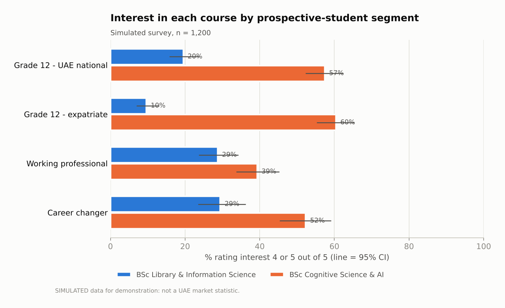
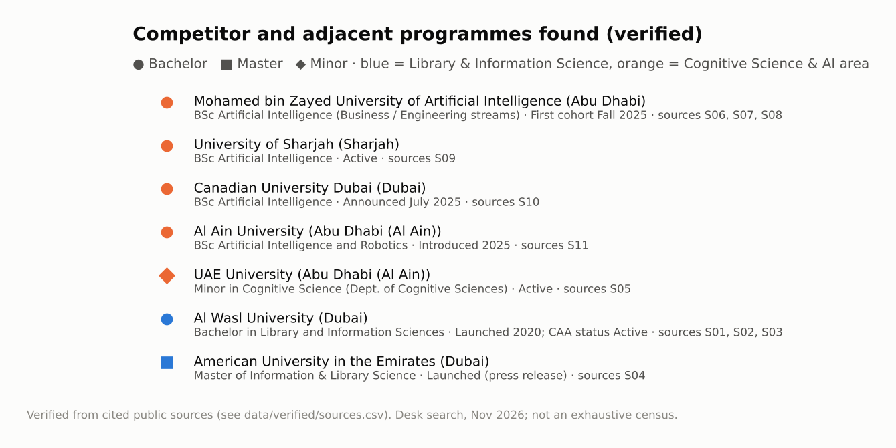
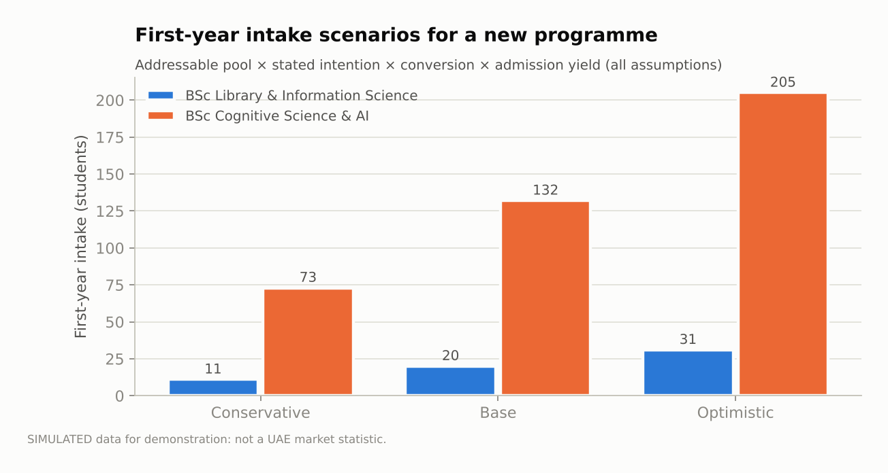
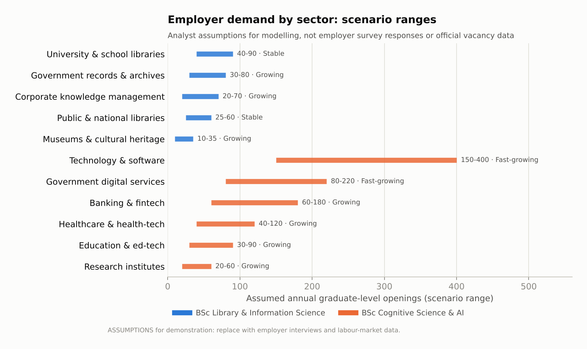
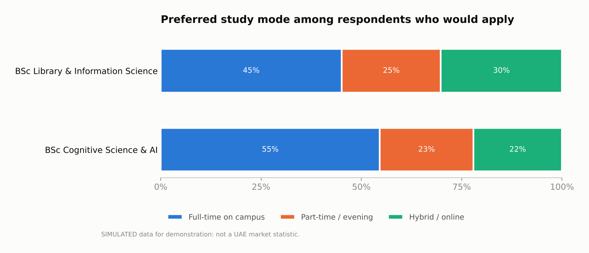

# UAE Higher Education Demand & Employment Research

A structured market-research project assessing demand and employment prospects for two proposed undergraduate programmes in the UAE:

1. **BSc Library & Information Science (LIS)**
2. **BSc Cognitive Science & Artificial Intelligence**

It combines **verified public information** (accredited programmes, competitor launches, national policy) with a **simulated** prospective-student survey and **assumption-based** employer and enrolment scenarios. The project produces competitor benchmarking, a course comparison, a role and skills map, charts, an Excel workbook and an 11-page PDF report.

> **⚠️ Evidence types are kept strictly separate.**
> - **Verified**: [`data/verified/`](data/verified/). Every fact cites a public source with a URL and access date ([`sources.csv`](data/verified/sources.csv)).
> - **Simulated**: [`data/synthetic/`](data/synthetic/). The survey is generated by code from documented assumptions ([`assumptions.py`](src/uae_research/assumptions.py)). **It is not a real survey, and its figures are not UAE market statistics.**
> - **Assumption**: employer-demand and enrolment inputs are modelling placeholders. They are **not** employer survey responses or official vacancy data.
> - **Analyst-compiled**: [`data/reference/`](data/reference/) holds a qualitative role and skills taxonomy.
>
> Every statement in the report is tagged [Verified], [Simulated] or [Assumption]. This repository reconstructs the *method* of research I carried out at The Digital Tantra; it contains no original client data or findings.



## Objectives

- Map existing UAE provision and competitors for each course, using verifiable sources.
- Estimate prospective-student demand by segment, study-mode preference, budget and decision factors (demonstrated on simulated data).
- Identify employment sectors, typical roles and the skills employers would need.
- Compare the two courses side by side and model first-year intake under explicit, testable assumptions, with sensitivity analysis.
- Produce a professional report with recommendations and a primary-research plan.

## Key verified findings (desk research, November 2026)

| | Finding | Sources |
|---|---|---|
| LIS | Al Wasl University (Dubai) offers a CAA-accredited Bachelor in Library and Information Sciences, launched in 2020 | S01-S03 |
| LIS | American University in the Emirates offers a Master of Information & Library Science | S04 |
| LIS | Mohammed bin Rashid Library opened in June 2022 with nine specialised libraries and over 1 million books | S15-S16 |
| CogSci & AI | AI bachelor's degrees at MBZUAI (first cohort 2025: 115 students from 2,000+ applicants), University of Sharjah, Canadian University Dubai and Al Ain University | S06-S11 |
| CogSci & AI | UAE University offers cognitive science as a **minor**. No combined CogSci + AI bachelor's was found in this search (to confirm against the CAA register). | S05, F15 |
| Policy | National Strategy for AI 2031 (announced 2017) targets AI talent. AI is taught in public schools from KG to Grade 12 from 2025-26 | S12-S14 |

## Results on the simulated data

| | BSc LIS | BSc Cognitive Science & AI |
|---|---|---|
| High interest (top-2-box), all respondents [S] | 20% | 53% |
| Would apply [S] | 14% | 27% |
| Want part-time / evening / hybrid study (intenders) [S] | 55% | 45% |
| Base-case first-year intake [S × A] | ~20 (range 11-31) | ~132 (range 73-205) |

These numbers reflect the generator's assumptions. They show how the analysis works and are not forecasts. The indicative conclusion, to be validated with primary research: Cognitive Science & AI has the stronger, more differentiated demand case, and LIS is a smaller opportunity best delivered flexibly to the existing library and records workforce.

## Technology stack

Python 3.11+ · pandas · NumPy · Matplotlib · openpyxl (Excel) · ReportLab (PDF) · pytest

## Folder structure

```
uae-higher-education-demand-employment-research/
├── run_pipeline.py                         # simulated data → analysis → charts → report
├── data/
│   ├── verified/                           # cited public information ONLY
│   │   ├── sources.csv                     # 17 sources with URLs and access dates
│   │   ├── verified_facts.csv              # 15 facts, each linked to sources
│   │   └── competitor_programmes.csv       # competitor & adjacent programmes
│   ├── reference/roles_and_skills_ANALYST_COMPILED.csv
│   └── synthetic/                          # SIMULATED survey + ASSUMPTION scenario inputs
├── src/uae_research/
│   ├── assumptions.py                      # every simulated input, in one file
│   ├── generate.py                         # synthetic survey generator (seeded)
│   ├── analysis.py                         # top-2-box + Wilson CIs, segments, scenarios, sensitivity, charts
│   ├── report.py / report_render.py        # report content → Markdown + PDF
├── outputs/figures/                        # 8 charts
├── outputs/tables/                         # 14 CSV tables + Excel workbook (with sources sheet)
├── reports/uae_higher_education_research_report.{pdf,md}
├── docs/survey_instrument.md               # questionnaire template for real fieldwork
└── tests/test_research.py                  # 10 tests: source integrity, labelling, maths
```

## Installation and running

```bash
git clone https://github.com/<your-username>/uae-higher-education-demand-employment-research.git
cd uae-higher-education-demand-employment-research
python -m venv .venv && source .venv/bin/activate     # Windows: .venv\Scripts\activate
pip install -r requirements.txt
python run_pipeline.py      # rebuilds data/synthetic, outputs/ and reports/
python -m pytest -q         # 10 tests
```

To run what-if scenarios, edit `src/uae_research/assumptions.py` (e.g. the addressable pool, conversion or yield) and re-run the pipeline. The report text is generated from the results, so it updates automatically.

## Method

- **Interest**: top-2-box share (4-5 on a 5-point scale) with 95% Wilson score intervals, by segment.
- **Intake model**: addressable pool × stated-intention rate × intention-to-application conversion × admission yield. There are three scenarios, and a one-at-a-time ±25% sensitivity analysis shows which assumption matters most.
- **Competitor benchmarking**: programmes found by desk search, classified by course area and level, each with sources.
- **Roles and skills**: an analyst-compiled taxonomy, visualised as a role × skill matrix to guide curriculum design.

## Screenshots

| | |
|---|---|
|  |  |
|  |  |

## Limitations

- **Simulated demand.** The survey and every number derived from it are synthetic. Use [`docs/survey_instrument.md`](docs/survey_instrument.md) to collect real data.
- **Employer demand is assumed.** No employer was surveyed or interviewed. The sector ranges are placeholders to be replaced with interviews, job-posting analysis and official labour-market data.
- **Desk search, not a census.** The competitor list may miss programmes. Check the full CAA programme register before making decisions.
- **Some facts come from secondary sources** (news, directories) where official pages were unavailable. Confirm critical facts with the institution.
- The facts were checked on 22 November 2026, and programme offerings change frequently.

## Licence

MIT, see [LICENSE](LICENSE). Cited sources remain the property of their publishers; this repository only references and links to them.
