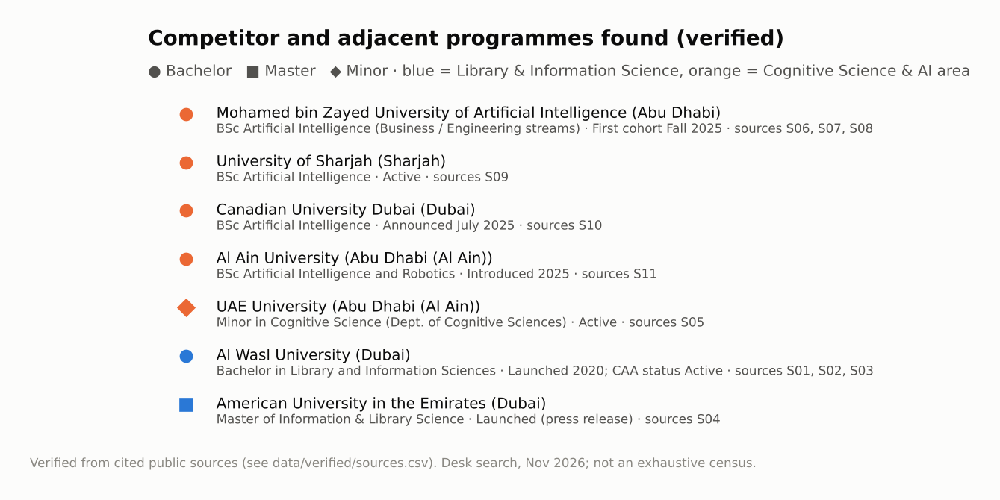
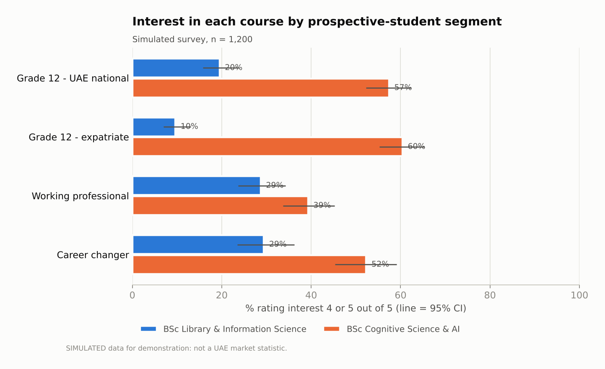
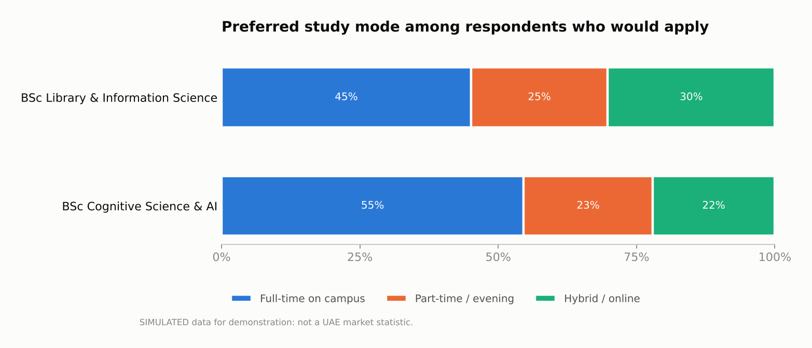
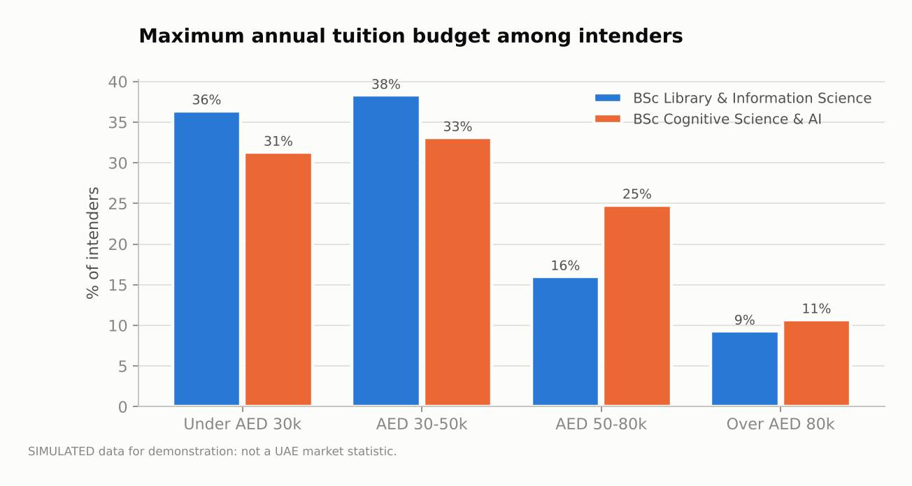
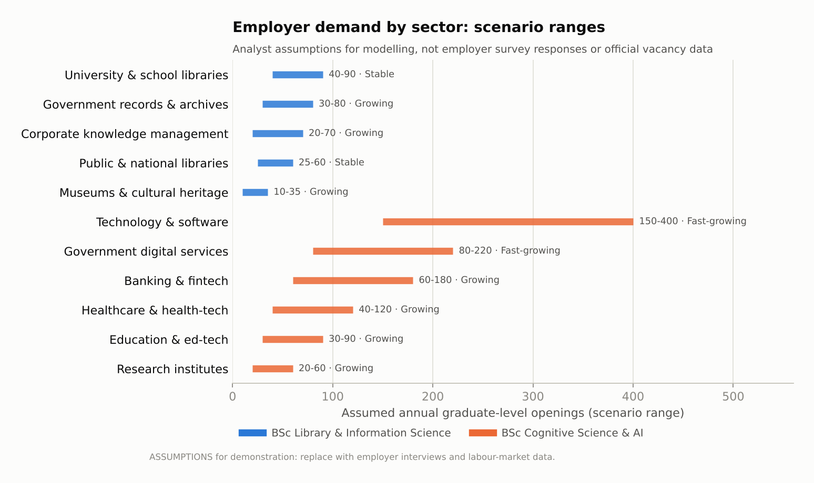
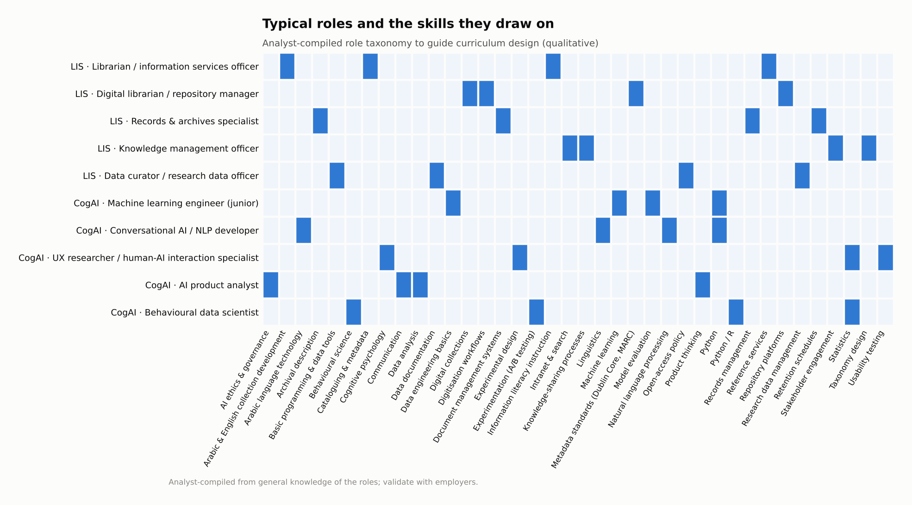
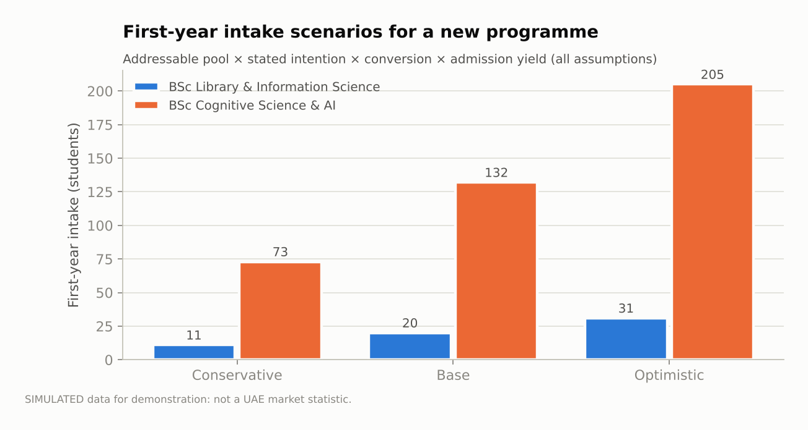
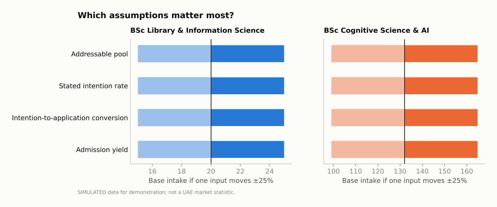

# UAE Higher Education Demand & Employment Research
*BSc Library & Information Science and BSc Cognitive Science & AI: a market-research demonstration*

Generated 21 November 2026 by `run_pipeline.py`.

## 1. Executive summary

This report mixes three kinds of evidence, and each statement is tagged. **[Verified]** facts come from the public sources listed in the appendix. **[Simulated]** results come from a synthetic prospective-student survey generated by code in this repository. **[Assumption]** figures are modelling inputs. Simulated results and assumptions are NOT UAE market statistics, survey responses or employer views, and must not be quoted as such.

- **[Verified]** The UAE already has an accredited undergraduate Library and Information Sciences degree at Al Wasl University in Dubai, launched in 2020, and a Master's at the American University in the Emirates. A new BSc in LIS would enter a small, niche market with one direct competitor.
- **[Verified]** AI undergraduate provision has grown quickly. MBZUAI, the University of Sharjah, Canadian University Dubai and Al Ain University all offer AI bachelor's degrees, most launched in 2025. MBZUAI's first cohort was 115 students from more than 2,000 applicants. This desk search found no programme that <i>combines</i> cognitive science with AI; UAE University offers cognitive science only as a minor.
- **[Verified]** Policy supports AI skills: the National Strategy for AI 2031 targets AI talent, and AI is taught in public schools from KG to Grade 12 from 2025-26.
- **[Simulated]** In the simulated survey, 53% rate high interest in Cognitive Science & AI against 20% for LIS. LIS interest is highest among career changers (29%), and Cognitive Science & AI among grade 12 - expatriates (60%).
- **[Simulated]**/**[Assumption]** Base-case first-year intake: about 132 students for Cognitive Science & AI (range 73-205) and about 20 for LIS (range 11-31). The result is most sensitive to the admission yield.
- **[Simulated]** 55% of would-be LIS applicants want part-time, evening or hybrid study, against 45% for Cognitive Science & AI. A flexible LIS format for working library and records staff looks more viable than a full-time-only cohort.

**Indicative conclusion (to validate with primary research):** a BSc in Cognitive Science & AI has the stronger demand case and a differentiated position, because it is interdisciplinary rather than another pure AI degree. A BSc in LIS is a smaller, flexible-delivery opportunity aimed at the existing library, archives and records workforce.

## 2. Scope and method

- Desk research on UAE institutions, accredited programmes, policy and the library and AI employer landscape (public sources, accessed November 2026).
- A synthetic survey of 1,200 prospective students across four segments and seven emirates, generated from documented assumptions (src/uae_research/assumptions.py) to demonstrate the analysis. A real study would replace this with a fielded survey.
- Course comparison, competitor benchmarking, a role and skills taxonomy, and an enrolment scenario model with sensitivity analysis.
- Interest is reported as top-2-box (% scoring 4-5 of 5) with 95% Wilson confidence intervals.

## 3. Verified landscape

**[Verified]** Facts from public sources, each traceable to the appendix:

| ID | Course | Fact | Sources |
|---|---|---|---|
| F01 | Library & Information Science | Al Wasl University (Dubai) offers a CAA-accredited Bachelor in Library and Information Sciences, listed with status Active. | S01;S02 |
| F02 | Library & Information Science | Al Wasl University's Bachelor in Library and Information Sciences is reported as launched in 2020. | S03 |
| F03 | Library & Information Science | The American University in the Emirates (Dubai) launched a Master of Information & Library Science through its College of Computer Information Technology. | S04 |
| F04 | Cognitive Science & AI | UAE University's Department of Cognitive Sciences offers majors in Psychology and Linguistics and a minor (not a major) in Cognitive Science. | S05 |
| F05 | Cognitive Science & AI | MBZUAI announced its first undergraduate programme, a BSc in Artificial Intelligence with Business and Engineering streams, in March 2025. | S06 |
| F06 | Cognitive Science & AI | MBZUAI's first undergraduate cohort numbered 115 students from more than 2000 applications (about 5% accepted). | S07 |
| F07 | Cognitive Science & AI | MBZUAI lists undergraduate tuition of USD 45000 per year for students entering in Fall 2025. | S08 |
| F08 | Cognitive Science & AI | University of Sharjah offers a four-year BSc in Artificial Intelligence in its College of Computing and Informatics. | S09 |
| F09 | Cognitive Science & AI | Canadian University Dubai announced a BSc in Artificial Intelligence in July 2025. | S10 |
| F10 | Cognitive Science & AI | Al Ain University introduced a BSc in Artificial Intelligence and Robotics and an MSc in AI in 2025. | S11 |
| F11 | Cognitive Science & AI | The UAE National Strategy for Artificial Intelligence 2031 (announced October 2017) includes attracting and training talent for AI-enabled jobs among its objectives. | S12;S13 |
| F12 | Cognitive Science & AI | From the 2025-26 academic year, AI is taught as a subject in UAE public schools from kindergarten to Grade 12, delivered by about 1000 teachers. | S14 |
| F13 | Library & Information Science | The Mohammed bin Rashid Library in Dubai opened to the public on 16 June 2022 with nine specialised libraries and over one million print and digital books. | S15;S16 |
| F14 | Cognitive Science & AI | UAE University has adopted an Artificial Intelligence Agenda 2025-2031 covering education and research. | S17 |
| F15 | Cognitive Science & AI | In this desk search (Nov 2026), no UAE institution was found offering a dedicated undergraduate degree combining Cognitive Science and AI. This is a search result, not proof that none exists; confirm against the CAA programme register. | S05;S06;S09;S10;S11 |

## 4. Prospective-student demand (simulated)

| Segment | Course | n | Mean (1-5) | Top-2 % | CI low | CI high | Would apply % |
|---|---|---|---|---|---|---|---|
| Grade 12 - UAE national | BSc Library & Information Science | 364 | 2.64 | 19.5 | 15.8 | 23.9 | 14.0 |
| Grade 12 - UAE national | BSc Cognitive Science & AI | 364 | 3.64 | 57.4 | 52.3 | 62.4 | 31.6 |
| Grade 12 - expatriate | BSc Library & Information Science | 364 | 2.28 | 9.6 | 7.0 | 13.1 | 8.0 |
| Grade 12 - expatriate | BSc Cognitive Science & AI | 364 | 3.77 | 60.4 | 55.3 | 65.3 | 28.6 |
| Working professional | BSc Library & Information Science | 275 | 2.97 | 28.7 | 23.7 | 34.3 | 19.3 |
| Working professional | BSc Cognitive Science & AI | 275 | 3.13 | 39.3 | 33.7 | 45.2 | 21.5 |
| Career changer | BSc Library & Information Science | 197 | 2.93 | 29.4 | 23.5 | 36.2 | 14.7 |
| Career changer | BSc Cognitive Science & AI | 197 | 3.48 | 52.3 | 45.3 | 59.1 | 24.4 |
| All respondents | BSc Library & Information Science | 1200 | 2.65 | 20.2 | 18.1 | 22.6 | 13.5 |
| All respondents | BSc Cognitive Science & AI | 1200 | 3.53 | 53.3 | 50.5 | 56.1 | 27.2 |

**[Simulated]** Among intenders, the top decision factor is 'career prospects' for both courses. 75% of LIS intenders and 64% of Cognitive Science & AI intenders cap their annual budget at AED 50k, so scholarships and instalment plans matter. For comparison, MBZUAI lists tuition of USD 45,000 per year [Verified, F07].

## 5. Employment opportunities

**[Assumption]** The scenario inputs assume 125-335 annual graduate-level openings for LIS graduates across 5 sectors and 380-1070 for Cognitive Science & AI graduates across 6 sectors. These are placeholders to show how employer demand feeds the model. They should be replaced with employer interviews, job-posting analysis and official labour-market data, none of which was collected for this demonstration.

| Course | Role | Typical sectors | Core skills |
|---|---|---|---|
| lis | Librarian / information services officer | Public, academic and school libraries | Cataloguing & metadata; Reference services; Information literacy instruction; Arabic & English collection development |
| lis | Digital librarian / repository manager | Universities, research centres | Digital collections; Metadata standards (Dublin Core, MARC); Repository platforms; Digitisation workflows |
| lis | Records & archives specialist | Government entities, large companies | Records management; Retention schedules; Archival description; Document management systems |
| lis | Knowledge management officer | Corporate, consulting, government | Taxonomy design; Intranet & search; Knowledge-sharing processes; Stakeholder engagement |
| lis | Data curator / research data officer | Universities, research institutes | Research data management; Data documentation; Basic programming & data tools; Open-access policy |
| cogai | Machine learning engineer (junior) | Technology, fintech, government | Python; Machine learning; Data engineering basics; Model evaluation |
| cogai | Conversational AI / NLP developer | Technology, government services | Natural language processing; Arabic language technology; Linguistics; Python |
| cogai | UX researcher / human-AI interaction specialist | Technology, banking, government | Experimental design; Cognitive psychology; Usability testing; Statistics |
| cogai | AI product analyst | Technology, consulting, fintech | Data analysis; Product thinking; AI ethics & governance; Communication |
| cogai | Behavioural data scientist | Healthcare, banking, research | Statistics; Behavioural science; Python / R; Experimentation (A/B testing) |

## 6. Course comparison

| Criterion | BSc Library & Information Science | BSc Cognitive Science & AI |
|---|---|---|
| Bachelor programmes found in UAE (verified) | 1 | 4 AI bachelors; 0 combined CogSci + AI found |
| Closest existing offer (verified) | Al Wasl University BLIS (Dubai, launched 2020) | AI bachelors (MBZUAI, UoS, CUD, AAU); UAEU cognitive science minor |
| Policy tailwind (verified) | Library sector investment, e.g. Mohammed bin Rashid Library (2022) | National AI Strategy 2031; K-12 AI curriculum from 2025-26 |
| Top-2-box interest (simulated) | 20% | 53% |
| Stated intention to apply (simulated) | 14% | 27% |
| Base-case first-year intake (scenario) | 20 students | 132 students |
| Assumed annual openings across sectors (assumption) | 125-335 | 380-1070 |
| Most preferred study mode among intenders (simulated) | Full-time on campus | Full-time on campus |
| Typical roles (analyst-compiled) | Librarian / information services officer; Digital librarian / repository manager; Records & archives specialist | Machine learning engineer (junior); Conversational AI / NLP developer; UX researcher / human-AI interaction specialist |

| Course | Scenario | Pool [A] | Intent [S] | Conv. [A] | Yield [A] | Applicants | Intake |
|---|---|---|---|---|---|---|---|
| BSc Library & Information Science | Conservative | 1800 | 0.135 | 0.1 | 0.45 | 24 | 11 |
| BSc Library & Information Science | Base | 1800 | 0.135 | 0.18 | 0.45 | 44 | 20 |
| BSc Library & Information Science | Optimistic | 1800 | 0.135 | 0.28 | 0.45 | 68 | 31 |
| BSc Cognitive Science & AI | Conservative | 9000 | 0.272 | 0.1 | 0.3 | 244 | 73 |
| BSc Cognitive Science & AI | Base | 9000 | 0.272 | 0.18 | 0.3 | 440 | 132 |
| BSc Cognitive Science & AI | Optimistic | 9000 | 0.272 | 0.28 | 0.3 | 685 | 205 |

## 7. Opportunities and recommendations

- **Position Cognitive Science & AI as interdisciplinary.** Combine machine learning with cognitive psychology, linguistics (including Arabic NLP) and human-AI interaction, so it is not a fifth general AI degree [based on F04, F05, F08-F10, F15].
- **Build the school-to-university pipeline.** Students now take AI from KG to Grade 12 [F12]. Outreach to Grade 11-12 students, teachers and counsellors fits the segment with the highest simulated interest.
- **Offer LIS in a flexible format.** Evening or hybrid delivery, credit for prior learning and a records & archives track suit working professionals and career changers (29% and 29% high interest, against 10-20% among school leavers [S]) and the assumed growth in digital-records roles [A].
- **Partner with employers early.** Libraries (e.g. Mohammed bin Rashid Library [F13]), government archives, technology firms and research institutes could provide internships, capstones and advisory-board input.
- **Make it affordable.** Most simulated intenders cap their budget at AED 50k a year. Model scholarships and instalment options before setting fees.
- **Run primary research before launch.** Field the survey design in docs/survey_instrument.md, interview 15-20 employers per course, analyse job postings, and check the full CAA programme register for any competitor this desk search missed.

## 8. Limitations

- Survey results, intake scenarios and employer demand figures are simulated or assumed. They demonstrate the method, not the UAE market.
- The competitor list comes from a desk search and is not an exhaustive census of UAE programmes. Programmes change frequently.
- Secondary sources (news and directories) were used where official pages were not reachable. Confirm critical facts with the institution or the CAA register.
- Roles and skills are an analyst-compiled taxonomy to guide curriculum design, not measured demand.

## Appendix: sources (accessed 22 November 2026)

| ID | Publisher | Title | URL |
|---|---|---|---|
| S01 | Commission for Academic Accreditation (CAA) | Accredited Programs: Bachelor in Library and Information Sciences (Al Wasl University) | https://www.caa.ae/Pages/Programs/Details.aspx?GUID=4111 |
| S02 | Commission for Academic Accreditation (CAA) | Al Wasl University: Renewal of Institutional Licensure executive summary (Feb 2022) | https://www.caa.ae/PORTALSUMMARYREPORTS/9/AWU%20Executive%20Summary.pdf |
| S03 | QS TopUniversities | Al Wasl University profile (lists Bachelor in Library and Information Sciences launched in 2020) | https://www.topuniversities.com/node/295315 |
| S04 | Zawya (press release) | American University in the Emirates launched Master of Information & Library Science | https://www.zawya.com/en/press-release/the-american-university-in-the-emirates-launched-master-of-information-amp-library-science-t9mz5aid |
| S05 | United Arab Emirates University | Department of Cognitive Sciences (majors in Psychology and Linguistics; minor in Cognitive Science) | https://uaeu.ac.ae/en/chss/departments/cognitive_sciences.shtml |
| S06 | MBZUAI | MBZUAI unveils first-of-its-kind undergraduate program in Artificial Intelligence (3 March 2025) | https://mbzuai.ac.ae/?p=21709 |
| S07 | The National | Inside Abu Dhabi's elite AI undergraduate programme (first cohort of 115; 2000+ applications) | https://www.thenationalnews.com/future/technology/2025/08/14/mohamed-bin-zayed-university-of-artificial-intelligence-welcomes-first-undergraduate-students |
| S08 | MBZUAI | Undergraduate application FAQ (Fall 2025 tuition USD 45000 per annum) | https://mbzuai.ac.ae/?p=21888 |
| S09 | University of Sharjah | Bachelor of Science in Artificial Intelligence (College of Computing and Informatics) | https://www.sharjah.ac.ae/Academics/Degree/Undergraduate/Artificial-Intelligence |
| S10 | Canadian University Dubai | CUD introduces Bachelor of Science in Artificial Intelligence (9 July 2025) | https://www.cud.ac.ae/node/25957 |
| S11 | Al Ain University | Al Ain University introduces BSc in AI and Robotics and MSc in AI (13 May 2025) | https://aau.ac.ae/en/news/2025/al-ain-university-reaffirms-its-commitment-to-advancing-artificial-intelligence-education |
| S12 | UAE Government (u.ae) | UAE National Strategy for Artificial Intelligence 2031 | https://u.ae/-/media/AI-publications/UAE-National-Strategy-for-Artificial-Intelligence-2031.pdf |
| S13 | OECD.AI Policy Navigator | UAE National Strategy for AI (announced October 2017) | https://oecd.ai/en/dashboards/policy-initiatives/uae-national-strategy-for-ai-8711 |
| S14 | Gulf News | UAE schools to introduce AI curriculum in new academic year (K-12 public schools from 2025-26; about 1000 teachers) | https://gulfnews.com/uae/education/uae-schools-to-introduce-ai-curriculum-in-new-academic-year-1.500242831 |
| S15 | Dubai Media Office | Ruler of Dubai inaugurates AED1 billion Mohammed bin Rashid Library (nine specialised libraries; over 1 million print and digital books) | https://mediaoffice.ae/en/news/2022/June/13-06/Ruler-of-Dubai-inaugurates-AED1-billion-Mohammed-bin-Rashid-Library |
| S16 | Khaleej Times | Dubai's Mohammed Bin Rashid Library opens to public (16 June 2022) | https://www.khaleejtimes.com/travel/uae-attractions/dubais-mohammed-bin-rashid-library-opens-to-public-today-all-you-need-to-know |
| S17 | United Arab Emirates University | UAEU carries out an AI agenda (Artificial Intelligence Agenda 2025-2031) | https://uaeu.ac.ae/en/news/2025/august/uaeu-carries-out-an-ai-agenda-and-expands-research-and-academic-programs.shtml |
